# Object Detection Phase Plan

## Objective

Replace the static camera fixtures with a separate camera analysis service. It
will read a mock video in the background, run object detection, and expose its
latest observation as JSON. Existing CrewAI tools will call that service when
an agent needs camera data.

For this phase, use **one short mock video and one configured camera**. Keep the
service boundary ready for RTSP streams later, without introducing a message
broker or a large-scale deployment design yet.

## Proposed Architecture

```mermaid
flowchart LR
    Video["Mock video file"] --> Source["Frame source and sampler"]
    Source --> Queue["Bounded latest-frame queue"]
    Queue --> Worker["Background detection worker"]
    Worker --> Model["YOLO detector"]
    Model --> Normalize["Normalize detections and timestamps"]
    Normalize --> Store["Bounded per-camera snapshot store"]
    Store --> CameraAPI["Camera analysis API"]

    User["User request"] --> MainAPI["CCTV API and workflow"]
    MainAPI --> Agent["Selected CrewAI agent"]
    Agent --> Tool["Camera tool"]
    Tool --> Client["Camera service client"]
    Client --> CameraAPI
    CameraAPI --> Client
    Client --> Tool
    Tool --> Agent
    Agent --> MainAPI
```



The analysis worker processes frames continuously. A tool call reads the
**latest available result**; it does not start video processing or run
inference on demand.

## Request and Data Flow

1. **Worker startup:** The camera service loads camera and model configuration,
   initializes YOLO once, and opens the configured mock video.
2. **Frame sampling:** The worker reads frames at a configurable interval.
   Start around **one frame per second**, then tune from measurements.
3. **Inference:** YOLO detects supported classes. The worker converts model
   output into the project’s camera observation format.
4. **Snapshot update:** The worker atomically appends the complete observation
   to a bounded per-camera in-memory snapshot store.
5. **Tool call:** After intent routing and camera authorization, a CrewAI tool
   calls the camera service over its internal HTTP API with the server-selected
   camera ID and optional snapshot/time selector. It does not send an entity or
   property filter.
6. **Response:** The service returns the complete snapshot for that camera and
   frame, including every detected object and its metadata. The tool passes the
   complete JSON unchanged to the agent. The agent interprets the user's
   question against that response and answers only from its contents.
7. **Freshness handling:** The service marks results as mock, fresh, stale, or
   unavailable. The agent must communicate stale or mock data clearly and must
   not present it as a current live-camera reading.

## Implementation Sequence

### 1. Define the Observation Contract and Capability Limits

Extend the existing contract in
[`app/services/camera_data_service.py`](app/services/camera_data_service.py)
to represent detector output consistently. Include:

- Camera ID and schema version
- Data status and source type
- Frame acquisition time, processing time, and source-video frame time
- Snapshot ID, camera ID, detection count, and complete detections array
- Detection class, confidence, bounding box, and optional tracker ID
- Optional safe metadata such as detector name and model version

Keep the distinction between **no detection** and **no recent observation**. A
new frame with zero people is a valid empty result; a failed or stopped worker
is unavailable or stale.

Before enabling an entity/property in
[`configs/cameras.yaml`](configs/cameras.yaml), confirm that the detector can
actually answer it. YOLO object detection can detect a door, but does not
inherently know whether it is open. Door state needs a separate state classifier
or suitable image logic. “Fan running” needs temporal motion evidence. Parking-
space availability needs configured parking-space regions or another occupancy
method. These should not be inferred from object presence alone.

### 2. Add the Standalone Camera Analysis Service

Suggested layout:

```text
camera_analysis_service/
  app/
    main.py
    config.py
    schemas.py
    api/
      routes/
        observations.py
    ingestion/
      worker.py
      sources/
        base.py
        mock_video.py
    detection/
      base.py
      yolo_detector.py
      postprocess.py
    storage/
      latest_observation_store.py
  configs/
    cameras.yaml
  tests/
```

The source and detector interfaces keep video reading separate from inference,
so an RTSP source can be added later without changing the tool-facing API.

For the initial version, run the workers and read API in the **same
camera-service process**. Keep a bounded per-camera ring buffer of complete
snapshots (for example, a configurable recent time window) so the latest and
recent snapshots can be queried without adding infrastructure prematurely. If
workers and the read API are later deployed as separate processes or replicas,
replace that store with shared storage such as Redis.

### 3. Implement the Mock-Video Worker

Start with one short, synthetic or approved video clip and one camera ID. The
worker should:

- Load weights once and perform a startup warm-up.
- Sample frames at a configurable rate rather than infer on every video frame.
- Use a **bounded queue**, preferably holding only the newest pending frame. If
  inference falls behind, drop old frames rather than build increasing latency.
- Store only normalized detection metadata, not video frames, in the observation
  store.
- Handle end-of-file and read failures with explicit loop/stop configuration
  and bounded retry/backoff.
- Report readiness only after model load and a successful frame-processing
  cycle.

Keep the video file out of normal API request processing. Do not make each user
request open or scan the clip.

### 4. Add the Queryable Camera Snapshot API

Provide internal endpoints along these lines:

```text
GET /internal/v1/cameras/{camera_id}/snapshots/latest
GET /internal/v1/cameras/{camera_id}/snapshots/{snapshot_id}
GET /internal/v1/cameras/{camera_id}/snapshots?from=...&to=...&limit=...
GET /health/live
GET /health/ready
```

The snapshot endpoint returns the **whole snapshot for one frame**. It must not
filter detections by entity/property or precompute a query-specific answer. A
snapshot includes all detections from that frame, including an empty detections
array when the frame was processed successfully and nothing was detected.

The worker assigns each observation a stable `snapshot_id`, camera ID,
`captured_at`/frame time, processing time, and provenance. `latest` returns the
newest complete observation; the ID endpoint retrieves a specific retained
observation; and the time-range endpoint returns complete snapshots in the
requested range, bounded by `limit` and the in-memory retention window. Query
parameters select camera and time/snapshot only; none filter detections inside
a snapshot.

Example complete snapshot response:

```json
{
  "snapshot_id": "demo-parking-000042",
  "camera_id": "demo-parking",
  "source": "mock_video_yolo",
  "data_status": "mock",
  "captured_at": "2026-11-26T12:00:42Z",
  "processed_at": "2026-11-26T12:00:42.180Z",
  "source_frame_time_ms": 42000,
  "detector": {"name": "yolo", "model_version": "configured-model"},
  "detections": [
    {
      "class_name": "car",
      "confidence": 0.94,
      "bbox": [194, 166, 442, 379],
      "track_id": null,
      "attributes": {}
    },
    {
      "class_name": "person",
      "confidence": 0.88,
      "bbox": [510, 122, 565, 301],
      "track_id": null,
      "attributes": {}
    }
  ]
}
```

The tool should request the complete snapshot for its authorized camera and
pass the full response to CrewAI. The agent may answer a question such as “is
there a person?” by inspecting the detections, but must not invent detections or
state that the JSON does not contain. Do not add a separate parking-summary
endpoint at this stage. In particular, do not claim available parking spaces
without defined spaces and a validated occupancy method.

Keep this API on a private service network and protect it with a service
credential. The public CCTV API must continue to perform user-level camera
authorization before the tool makes an internal request.

### 5. Replace the In-Process Mock Service with an HTTP Adapter

Keep the existing `CameraDataService` boundary so the tools in
[`app/orchestration/camera_tools.py`](app/orchestration/camera_tools.py) remain
stable, but change its live implementation to fetch a whole snapshot. Add an
HTTP implementation and select it through
[`app/services/camera_service_provider.py`](app/services/camera_service_provider.py).

Because CrewAI currently invokes synchronous Python tools, use a synchronous
HTTP client with connection pooling and a short, configured timeout for these
calls. Configure the camera service URL and service credential through
environment variables. Do not log the credential or include it in URLs.

The tool remains responsible for mapping a validated intent to its configured
camera ID and enforcing the user’s allowed-camera list. The LLM must not choose
arbitrary camera IDs. Remove object/property filtering from the service request
path; tool inputs may retain the original user question for trace context, but
the camera API query selects a camera/snapshot, not a requested object.

### 6. Update Agent Instructions and Tracing

Update camera-agent instructions to:

- Use only the tool response for camera-state claims.
- State that results come from the mock video during this phase.
- Explain when the observation is stale or unavailable.
- Inspect the full detections array to answer the requested object question;
  the API does not pre-filter detections or answer the question itself.
- Avoid claiming unsupported properties such as door state until the
  appropriate capability exists.

Continue recording tool duration, status, source, camera ID, and observation
age in Jaeger. Keep frame pixels and credentials out of logs and traces.
Detection payload capture should remain controlled by the existing trace
capture settings.

### 7. Add Reliability Tests and a Small Evaluation Set

Cover the end-to-end path: mock video → worker → complete latest snapshot
endpoint → HTTP camera adapter → tool → agent response. Include tests for:

- Complete snapshot JSON validation, including multiple object classes
- Snapshot selection by camera and snapshot ID
- Tool passes all detections through without object/property filtering
- Empty but fresh observations
- Stale observations and worker failures
- Camera service timeout and unavailable responses
- Invalid camera IDs and unauthorized camera access
- Video EOF/restart behavior
- Tool response marking mock data accurately

Measure frame sampling rate, inference time, observation age, and tool-call
latency before tuning model size or concurrency.

## Main Bottlenecks and Mitigations

| Bottleneck or risk | Plan |
|---|---|
| YOLO is slower than video decoding | Sample frames; use a one-frame latest queue and drop old frames. |
| High-resolution frames increase inference time | Resize to a configured inference resolution and measure accuracy impact. |
| Inference blocks the CCTV request API | Keep inference in the separate camera service; tool requests only read cached results. |
| Stale results look like current results | Track processing time and freshness; expose stale/unavailable explicitly. |
| Detection counts fluctuate across frames | Initially report per-snapshot counts; evaluate tracking or temporal smoothing as a later step. |
| Object detection is mistaken for state detection | Gate entities/properties by implemented capabilities; add specialized state models separately. |
| Parking availability is guessed from vehicle count | Require configured parking-space regions or return only vehicle count. |
| Multiple service replicas have inconsistent memory | Begin with one camera-service instance; move latest results to shared storage when adding replicas. |
| Model weights or video are large | Keep artifacts outside source control; configure paths or mounted volumes. |

## Terminology

- **Ingestion:** Reading and sampling frames from a video source.
- **Inference:** Running the detection model on a frame.
- **Observation:** The normalized detection result for a particular frame.
- **Latest observation store:** A small store of the newest result per camera,
  not an archival database.
- **Freshness:** How long ago the observation was processed.
- **Frame queue:** The bounded handoff between decoding and inference; dropping
  old frames protects latency.
- **Tracking:** Linking detections across frames; distinct from detecting
  objects in one frame.

## Phase-One Acceptance Criteria

- The analysis service runs separately from the CCTV API and processes the
  configured mock video without user requests.
- Its readiness endpoint succeeds only after the model and worker are
  producing observations.
- A camera tool call returns the complete latest snapshot through the camera
  service API, including all detected object classes for that frame.
- Mock, stale, empty, and unavailable results remain distinguishable to both
  tools and agents.
- User-level camera authorization still occurs before service access.
- Supported response claims match actual model capabilities; unsupported state
  queries are handled honestly.
- A single camera can be exercised end to end before adding RTSP, multiple
  replicas, or persistent observation history.
